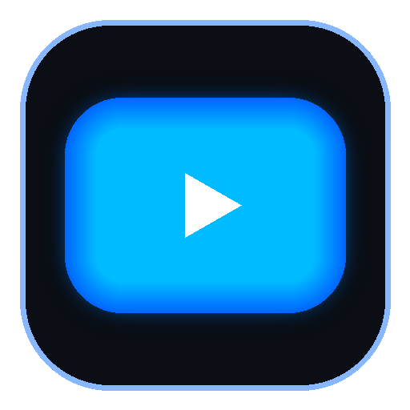

# AuraTube ⚡

> **AuraTube**: A high-performance, ad-free, libre YouTube and Shorts streaming client built in Flutter, powered by NewPipe extraction architecture and hardware DSP multi-band sound shaping.

<p align="center">
  
</p>

---

## 🌟 Key Features

* **⚡ Pure Ad-Free Streaming**: Zero interruptions, direct stream resolution without ads.
* **🎧 Background Playback**: Listen with the screen off or while browsing other apps.
* **🎛️ Sound Shaping & Multi-Band DSP Equalizer**: Integrated hardware equalizer with presets (*Bass Heavy, Rock, Pop, Vocal, Electronic, Flat*) and analog sub-bass boost.
* **⚡ YouTube Shorts Feed**: Seamless vertical swipe video experience with comment drawers and instant interaction.
* **🛡️ NewPipe Privacy Architecture**: 100% offline, local subscription management, watch history, and bookmarks — no Google login or telemetry required.
* **📥 Media Downloader**: Save high-definition video (MP4) and audio (M4A) directly to local storage.
* **💬 Real-Time Comments**: Deep comment thread extraction and pagination.
* **💎 Ultra-Modern Blue Aesthetic**: Electric blue accents (`#0066FF`), neon cyan glow, rounded cards (Material 3), and FontAwesome icons (no emojis in UI controls).

---

## 👨‍💻 Author & Creator

**Muhammad Taezeem Tariq**  
* UPI ID: `7006616470@fam`  
* Package ID: `com.taezeem.auratube`  
* Version: `1.0.0`

---

## 🛠️ Tech Stack & Architecture

* **Framework**: Flutter 3.41.3 / Dart 3.11.1
* **Streaming & Extraction**: `youtube_explode_dart` (NewPipe-compatible engine)
* **Audio Engine**: `just_audio` + `audio_service` + `audio_session` (Foreground media notification & DSP)
* **Video Engine**: `video_player` with custom rounded scrubber controls
* **State Management**: `provider`
* **Local Persistence**: `shared_preferences`

---

## 🚀 Building & Running

```bash
# Get dependencies
flutter pub get

# Build APK (Required flag for FontAwesome icons)
flutter build apk --no-tree-shake-icons
```
